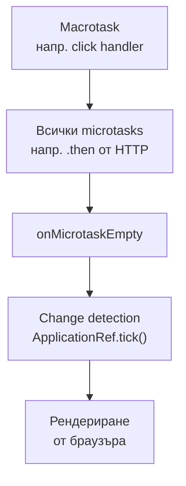

# Event loop в Angular: Zone.js, change detection и планирането на работа

Този файл свързва модела от [[browser-event-loop]] с Angular. Основните понятия идват от javascript.info. Връзката с Angular е от документацията на Angular и от общото познаване на framework-а. *Детайлите за вътрешната имплементация на Zone.js и на zoneless scheduler-а са описани на нивото, нужно за интервю, а не като спецификация.*

## Защо Angular изобщо се интересува от event loop-а

Angular трябва да знае **кога** да обнови екрана. Състоянието на приложението се променя почти винаги в асинхронен код: в handler на клик, в отговор на HTTP заявка или в таймер. Всяко от тях е макро- или микрозадача. Въпросът „кога да пусна change detection“ на практика е въпросът „кога е приключила задачата, която може да е променила данните“.

Има два отговора на този въпрос: стария чрез Zone.js и новия, zoneless.

## Zone.js: прихващане на всяка задача

Zone.js прави **monkey patching** на асинхронните API-та на браузъра. Подменя `setTimeout`, `setInterval`, `Promise.then`, `addEventListener`, `XMLHttpRequest` и други с обвивки, които изпълняват оригинала, но и известяват зоната. Така Angular знае за всяка задача кога е поставена на опашката, кога започва и кога свършва.

Ключовият момент е събитието `onMicrotaskEmpty` на `NgZone`. То се излъчва, когато текущата макрозадача е приключила **и** микроопашката е изпразнена. Тогава Angular пуска change detection чрез `ApplicationRef.tick()`.



Това положение в цикъла има важно следствие. Change detection тече **след** микрозадачите и **преди** браузърът да рисува. Затова промените, направени в Promise верига след клик, се виждат в същия кадър. Потребителят никога не вижда междинно състояние, при което данните вече са нови, а екранът още е стар.

С образа на кухнята от предишния файл: Zone.js е контрольор, който стои до гишето. Всеки път, щом готвачът приключи поръчка и всички дребни довършителни задачи към нея, контрольорът проверява цялата зала и обновява менютата по масите. Едва после сервитьорът носи храната.

## Цената: change detection след всяко събитие

Zone.js не знае **дали** една задача е променила данни. Знае само, че е приключила. Затова пуска change detection след **всяка** задача в зоната. При събития с висока честота като `mousemove`, `scroll` или `requestAnimationFrame` цикъл това означава десетки проверки на цялото дърво в секунда, обикновено без реална нужда.

Решението в света на Zone.js е `NgZone.runOutsideAngular`. Код, регистриран в него, не задейства change detection.

```typescript
export class ListingGallery {
  private readonly ngZone = inject(NgZone);
  private readonly host = inject(ElementRef);

  constructor() {
    this.ngZone.runOutsideAngular(() => {
      this.host.nativeElement.addEventListener('scroll', () => this.updateParallax());
    });
  }
}
```

Ако в такъв handler все пак трябва да се обнови нещо в темплейта, кодът се връща обратно в зоната с `ngZone.run(...)`.

## Хаковете със `setTimeout` и `Promise.resolve()` срещу NG0100

Грешката `ExpressionChangedAfterItHasBeenCheckedError`, описана в [[angular-component-lifecycle]], често се „поправя“ с отлагане на промяната.

```typescript
ngAfterViewInit() {
  Promise.resolve().then(() => this.isReady = true);
  // или
  setTimeout(() => this.isReady = true);
}
```

Event loop-ът обяснява защо и двата варианта „работят“ и защо се различават. И в двата случая промяната се случва **след** текущия цикъл на change detection, затова контролната проверка в development режим вече не я вижда като нарушение.

С `Promise.resolve().then` промяната е микрозадача. Тя се изпълнява веднага след текущата задача, Zone.js пуска нов цикъл на change detection и всичко се случва **преди** рисуването. Потребителят вижда само крайното състояние.

С `setTimeout` промяната е нова макрозадача. Между нея и текущата задача браузърът може да нарисува кадър със старата стойност. Резултатът може да е видимо примигване.

Двата хака са симптом, а не решение. NG0100 сигнализира, че потокът на данните не е еднопосочен. Правилната поправка е стойността да се изчисли по-рано, например в `ngOnInit` или в `computed`, вместо да се отлага промяната.

## `afterNextRender` и layout thrashing

Фазите на `afterNextRender` и `afterEveryRender`, описани в [[angular-component-lifecycle]], имат смисъл чак когато се види как браузърът рендерира.

Рендерирането има стъпки: стилове, layout и рисуване. Обикновено браузърът ги изпълнява веднъж, в края на задачата. Но ако код **прочете** геометрично свойство като `offsetHeight` или `getBoundingClientRect()` веднага след като е **записал** промяна в стилове, браузърът е принуден да изчисли layout-а синхронно, насред задачата. Иначе не може да върне верен отговор. Ако записите и четенията се редуват в цикъл, layout-ът се изчислява наново при всяко четене. Това се нарича **layout thrashing** и е една от най-честите причини за бавни задачи.

Фазите `write` и `read` на `afterNextRender` подреждат всички записи от всички компоненти преди всички четения. Така layout-ът се изчислява веднъж, а не по веднъж на компонент.

## RxJS schedulers: event loop-ът в операторите

RxJS позволява да се избере в коя опашка да се изпълни работата чрез **schedulers**. Всеки от тях съответства на механизъм от event loop-а.

| Scheduler                 | Механизъм в браузъра    | Кога се изпълнява                   |
| ------------------------- | ----------------------- | ----------------------------------- |
| `queueScheduler`          | синхронно               | веднага, в текущия call stack       |
| `asapScheduler`           | microtask               | след текущия код, преди рендериране |
| `asyncScheduler`          | `setTimeout`, macrotask | в следващ цикъл                     |
| `animationFrameScheduler` | `requestAnimationFrame` | преди следващия кадър               |

`asyncScheduler` е по подразбиране за всички оператори, които работят с време. Такива са `debounceTime`, `delay`, `throttleTime`, `interval` и `timer`. Затова `debounceTime(300)` в търсенето от [[rxjs-flattening-operators]] е всъщност таймер, тоест макрозадача. Със Zone.js тя задейства change detection, когато изтече.

`observeOn(animationFrameScheduler)` е удобен начин визуални обновявания от поток, например позиция при плъзгане, да се синхронизират с кадрите на браузъра.

## Zoneless: Angular сам планира change detection

В zoneless приложение няма monkey patching. Angular вече не научава автоматично за всяка задача. Вместо това change detection се **планира**, когато Angular получи изрично известие, че нещо се е променило. Известията са следните:

- промяна на signal, прочетен в темплейт
- `markForCheck()`, който се извиква и от `async` pipe
- event handler, свързан в темплейта
- `setInput` при динамично създадени компоненти

При такова известие Angular планира един цикъл на change detection, който обединява всички промени от текущата задача.

Практическото следствие е точно обратно на Zone.js. Обикновено поле, променено в `setTimeout` или в `subscribe` callback, **няма** да обнови екрана, защото никой не е известил Angular. Затова в zoneless приложение състоянието, видимо в темплейта, трябва да е в signals или да минава през `async` pipe. Ценната страна е, че change detection тече само когато нещо наистина се е променило, а не след всеки `mousemove`.

## SSR: стабилността на приложението

При server-side rendering event loop-ът има още една роля. Angular трябва да знае кога приложението е **стабилно**, тоест кога всички заявки и таймери, нужни за първоначалното рендериране, са приключили, за да сериализира HTML-а. Със Zone.js това се определя по липсата на чакащи макрозадачи в зоната. В zoneless приложение Angular следи `PendingTasks`: HTTP заявките се регистрират автоматично, а собствена асинхронна работа може да се регистрира ръчно.

Оттук идва класически SSR бъг. `setInterval` или безкраен `interval` от RxJS, стартиран при инициализация, например за въртяща се галерия, държи приложението вечно нестабилно. Сървърът чака, докато изтече timeout, или рендерирането се забавя значително. Решението е такъв код да се стартира само в браузъра. Може да се провери платформата или кодът да се постави в `afterNextRender`, който не се изпълнява на сървъра.

## Изречението за интервю

> Със Zone.js Angular прихваща асинхронните API-та и пуска change detection в `onMicrotaskEmpty`, тоест след като макрозадачата и всички микрозадачи са приключили и преди браузърът да рисува. Затова промени в Promise верига се виждат в същия кадър. Цената е change detection след всяко събитие, затова честите събития се регистрират в `runOutsideAngular`. Хаковете срещу NG0100 се различават по опашката: `Promise.resolve()` е микрозадача, без примигване, а `setTimeout` е макрозадача, между която и текущата браузърът може да рисува. В zoneless Angular не следи задачите, а планира change detection при известие от signal, `markForCheck` или template събитие, затова състоянието в темплейта трябва да е в signals. При SSR безкрайни таймери държат приложението нестабилно и блокират сериализацията.
