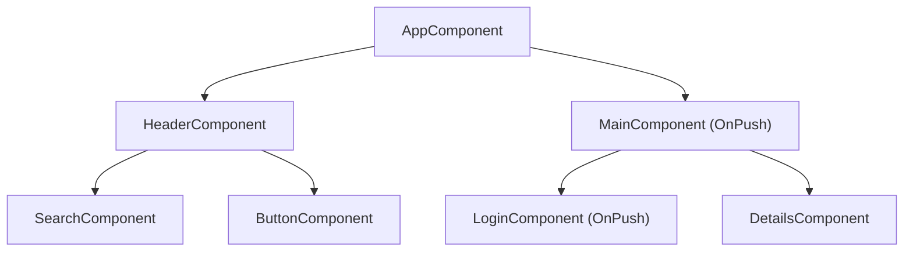

# Change detection в Angular, част 2: OnPush

https://angular.dev/best-practices/skipping-subtrees

Този файл продължава от [[change-detection-zonejs]]. Там Андрей удря главното звънче при всяко събитие, а Инспекторът обикаля цялата къща. OnPush не променя Андрей. Звънчето продължава да бие както преди. OnPush променя Инспектора: той вече не влиза във всяка стая, а прескача стаи, за които знае, че нищо не се е променило.

## Какво е OnPush

OnPush е стратегия за change detection, която казва на Angular да проверява поддървото на даден компонент **само** когато има конкретна причина за това. Когато няма такава, Инспекторът прескача не само компонента, но и **цялото му поддърво**. В голямо приложение с много компоненти това спестява огромна част от работата при всеки цикъл.

От **Angular 22 OnPush е стратегията по подразбиране**. Старата стратегия, която проверява всеки компонент при всеки цикъл, вече се казва `ChangeDetectionStrategy.Eager`, а не `Default`. Това е важна новост за интервю. В приложения на по-стари версии, включително повечето реални проекти, OnPush все още се задава изрично:

```typescript
@Component({
  selector: 'app-listing-card',
  changeDetection: ChangeDetectionStrategy.OnPush,
  template: `...`,
})
export class ListingCard {}
```

С образа на къщата: на вратата на всяка OnPush стая има табелка „не влизай, освен ако“. Инспекторът минава покрай нея, без да отваря, освен ако не е изпълнено някое от условията на табелката.

## Кога OnPush компонентът се проверява

Документацията изброява две основни причини за проверка на OnPush поддърво.

Първата е, че **root компонентът на поддървото получава нов input** чрез template binding. Angular сравнява текущата и предишната стойност на input-а с `Object.is`. Това означава сравнение по **референция** за обекти и масиви, а не по съдържание.

Втората е, че Angular **обработва събитие** в root компонента на поддървото или в някое от децата му. Това може да е event binding в темплейта, output binding или `@HostListener`. Няма значение дали децата са OnPush или не.

Към тях се добавят механизмите, които маркират компонента за проверка изрично или автоматично. `async` pipe маркира компонента, когато observable-ът излъчи нова стойност, като вътрешно вика `markForCheck()`. Signal, прочетен в темплейта, маркира компонента, когато стойността му се промени. Ръчното извикване на `ChangeDetectorRef.markForCheck()` прави същото.

Всичко останало **не** предизвиква проверка на OnPush компонент. Такива са например `setTimeout` в компонента, `subscribe` с присвояване на поле или мутация на обект, подаден като input.

## Как работи маркирането

За да се разбере кога точно OnPush компонент се проверява, трябва да се знае, че маркирането върви **нагоре**. Когато в компонент се случи събитие или бъде извикан `markForCheck()`, Angular маркира като „мръсни“ не само този компонент, а и **всичките му предци до root**. Причината е, че обхождането винаги започва от root. За да стигне Инспекторът до мръсен компонент дълбоко в дървото, той трябва да има право да мине през всички OnPush врати по пътя.

Затова `markForCheck()` сам по себе си не пуска change detection. Той само маркира пътя. Проверката се случва при следващия цикъл, който със Zone.js идва след края на текущата задача, а в zoneless приложение се планира от самото извикване.

## Сценариите от документацията

Документацията илюстрира правилата с едно дърво. `Main` и `Login` са OnPush, всички останали компоненти са `Eager`.



**Събитие в Eager компонент извън `Main`**, например клик в `Button`. Angular проверява цялото дърво, но прескача OnPush поддървата, които не са получили нови inputs. Проверени са `App`, `Header`, `Search` и `Button`. Цялото поддърво на `Main`, включително `Details`, е прескочено.

**Събитие в `Main`**. Angular проверява цялото дърво, но прескача OnPush поддървата, които са извън компонента, обработил събитието, и не са получили нови inputs. Тук е прескочено поддървото на `Login`. Събитието е в `Main`, а не в `Login`, и `Login` е OnPush.

**Събитие в `Login`**. Angular проверява цялото дърво, **включително предците** на `Login`. `Main` също е проверен, макар да е OnPush, защото `Login` е част от неговото view. Това е маркирането нагоре от предишния раздел в действие.

**Нов input към `Main`**. `App` подава нова стойност на `Main` чрез template binding. Angular проверява `Main`, но не и `Login`, който също е OnPush. `Login` се проверява само ако и той получи нов input.

Общият извод е, че OnPush не изолира компонента от света. Той изолира компонента от **несвързани** промени. Промените, които идват по ясен път, през input, събитие в поддървото или изрично маркиране, винаги стигат до него.

## Капаните, описани в документацията

**Мутация на обект, подаден като input.** Ако input получава обект и този обект бъде променен, но референцията остане същата, Angular не пуска проверка. За `Object.is` предишната и текущата стойност са един и същ обект.

```typescript
// не обновява OnPush дете
this.listing.price = 120_000;

// обновява, защото референцията е нова
this.listing = { ...this.listing, price: 120_000 };
```

Затова OnPush и **непроменимите данни** вървят заедно. Всяка промяна създава нов обект. Това е същият принцип, на който стъпват чистите reducers и мемоизираните selectors в [[ngrx-architecture]]. Там е обяснено и защо промените се откриват по референция.

**Промяна на input от TypeScript код.** Ако родителят вземе референция към дете чрез `viewChild` или `contentChild` и промени input свойство директно, Angular не пуска проверка на OnPush детето. Промяната не идва от template binding. Решението е `markForCheck()` или, по-добре, промяната да минава през темплейта.

## Най-честият бъг: `subscribe` и присвояване на поле

Най-често срещаната грешка при въвеждане на OnPush е следният код:

```typescript
export class ListingDetails {
  protected listing?: Listing;

  constructor() {
    inject(ListingsApiService).getListing(id)
      .pipe(takeUntilDestroyed())
      .subscribe((listing) => this.listing = listing);
  }
}
```

Със стратегията `Eager` кодът работи, защото Zone.js пуска проверка след HTTP отговора и Инспекторът влиза във всяка стая. С OnPush Zone.js пак пуска цикъла, но Инспекторът не влиза в стаята. Няма нов input, няма събитие в поддървото и никой не е маркирал компонента. Данните са пристигнали, но екранът остава празен.

Има три правилни решения, подредени от най-препоръчваното.

Първото е **signal**: `protected readonly listing = toSignal(this.listingsApi.getListing(id))`. Прочитането в темплейта автоматично маркира компонента при промяна.

Второто е **`async` pipe**: `listing$` в класа и `@if (listing$ | async; as listing)` в темплейта. Pipe-ът сам вика `markForCheck()`.

Третото е **ръчно `markForCheck()`** в `subscribe`. То работи, но е най-лесно да се забрави и най-трудно да се поддържа.

## `markForCheck`, `detectChanges` и `detach`

`ChangeDetectorRef` предлага три основни метода, които често се бъркат на интервю.

**`markForCheck()`** маркира компонента и предците му за проверка при **следващия** цикъл. Той не изпълнява нищо веднага. Това е правилният избор в почти всички случаи, защото оставя Angular да реши кога да проведе цикъла.

**`detectChanges()`** изпълнява change detection **веднага и синхронно**, но само за този компонент и неговите деца. Той не минава през предците. Използва се рядко, например когато компонент е откачен от дървото или когато DOM трябва да е обновен още в текущия ред код, преди следващата стъпка.

**`detach()`** и **`reattach()`** откачат и закачат компонента обратно към обхождането. Откачен компонент не се проверява изобщо, докато не бъде закачен обратно или докато не се извика `detectChanges()` ръчно. Това е инструмент за крайни случаи, като компонент с данни в реално време, който се обновява по собствен график.

## Signals в OnPush компонент

Signals правят OnPush по-прецизен. Когато signal, прочетен в темплейта на OnPush компонент, промени стойността си, Angular маркира компонента за проверка без нито `async` pipe, нито `markForCheck()`. Документацията на Signals описва точно това поведение.

Има и още по-фин детайл, който идва от вътрешната реализация, а не от тези страници на документацията. При промяна на signal Angular маркира като мръсен **само** view-то, което го чете. Предците се отбелязват само като път към него. Тоест при обхождането те се минават, но техните bindings не се преизчисляват. При `markForCheck()` обратно всички предци се маркират като мръсни и се проверяват. Затова signals дават по-малко работа от `async` pipe дори в OnPush дърво. Този механизъм се нарича понякога локален change detection. Повече подробности има в [[change-detection-signals-zoneless]].

## Втората конфигурация на къщата

Със Zone.js и OnPush Андрей продължава да удря главното звънче при всяко събитие. Инспекторът обаче прескача OnPush стая и цялото ѝ поддърво, освен ако тя не е получила нов input по референция, не е имало събитие вътре в нея или в децата ѝ, `async` pipe не е излъчил, signal в темплейта не се е променил или някой не е извикал `markForCheck()`. Работа, изгубена в непроменени поддървета, намалява драстично.

OnPush е и подготовката за zoneless. Компонент, който работи правилно с OnPush, вече известява Angular изрично за промените си. Документацията на zoneless описва OnPush съвместимостта като препоръчителната стъпка към премахване на Zone.js.

## Изречението за интервю

> OnPush казва на Angular да прескача поддървото на компонента, освен ако root-ът му не получи нов input през template binding, който се сравнява с `Object.is`, тоест по референция. Проверка има и ако в поддървото не се обработи събитие, `async` pipe не излъчи, signal в темплейта не се промени или не се извика `markForCheck()`. Маркирането върви нагоре до root, затова събитие в дълбок OnPush компонент проверява и предците му. Най-честите капани са мутация на обект без нова референция и `subscribe` с присвояване на поле, което OnPush не вижда. Решенията са непроменими данни и signals или `async` pipe. От Angular 22 OnPush е по подразбиране, а старата стратегия се казва `Eager`.
