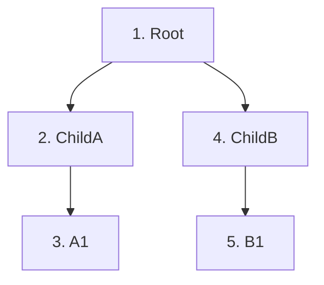

# Change detection в Angular, част 1: механизмът и Zone.js

https://angular.dev/best-practices/skipping-subtrees
https://angular.dev/guide/zoneless

Това е първият от четири свързани файла. Този описва какво е change detection и как го задейства Zone.js. [[change-detection-onpush]] описва OnPush. [[change-detection-signals-zoneless]] описва Signals и zoneless. [[change-detection-frameworks]] сравнява Angular с другите frameworks.

## Действащите лица

Историята продължава семейната сага. **Румяна** е Angular SPA приложението, цялото домакинство със стаите, обитателите и всекидневието. **Пламен** е Service Worker-ът, пазачът на портата, който управлява движението между домакинството и външния свят. **Андрей** е Zone.js, вътрешният иконом, който живее в къщата и удря главното звънче всеки път, когато се случи каквото и да е. **Инспекторът** е самият change detection. Той не е личност, а процес. Когато Андрей удари звънчето, Инспекторът минава през къщата отгоре надолу и сравнява какво има във всяка стая с това, което показва прозорчето ѝ навън.

Стаите са компонентите. Прозорчетата са темплейтите, тоест bindings към DOM. Нещата в стаята са състоянието на компонента.

## Историята

Румяна се нанася в голяма многоетажна къща. Всяка стая има умно стъкло на вратата, което показва на минувачите какво има вътре. Бедата е, че ако Румяна премести вазата в трапезарията и никой не обнови прозорчето, минувачите виждат остаряла картина. Целият смисъл на прозорчетата е винаги да отразяват реалността.

Затова Румяна наема Андрей, иконом от старата школа с една мания. Той слага малко звънче на всяка врата, всеки телефон, всяка пощенска кутия, всеки часовник и всеки чайник в къщата. Когато нещо издаде звук, Андрей го чува и удря главното звънче. Тогава се събужда Инспекторът. Той започва от най-горния етаж, слиза през всяка стая, сравнява и обновява прозорчетата, където има разлика, и пак заспива.

Системата работи безупречно години наред. Всяка промяна, която Румяна прави, стига до прозорчетата. Но е шумна. Звънчето бие постоянно и Инспекторът обикаля цялата къща стотици пъти на ден, дори когато нищо важно не се е променило.

Един ден Румяна чува за нова система: сензори вътре в самите мебели. Вазата сама съобщава на прозорчето, когато бъде преместена. Няма главно звънче и няма обиколка из цялата къща. Това е пътят от Zone.js с обхождане на цялото дърво, през OnPush и Signals, до zoneless Angular.

## Какво всъщност е change detection

Работата на Angular е да поддържа DOM синхронизиран със състоянието на компонентите. Темплейтът е декларативен: `{{ user.name }}` казва „на това място показвай текущата стойност на израза“. JavaScript обаче не съобщава на никого, когато `user.name` бъде променено. Няма вграден механизъм, който да следи записа в свойство на обикновен обект.

Затова Angular има нужда от процес, който се задейства, обхожда дървото от компоненти и преизчислява всеки binding израз във всеки темплейт. После сравнява новата стойност с последната запомнена и обновява само DOM възела, чийто binding се е променил. Този процес е change detection.

Три уточнения правят менталния модел точен.

Първото е, че това **не е повторно рендериране**. Angular не изхвърля DOM и не го изгражда наново. Той прави точкови промени само в bindings, чиито стойности са различни.

Второто е, че това **не е сравнение на дървета**, както при virtual DOM в React. Angular прави **dirty checking**: преизчислява всеки израз и го сравнява със запомнената предишна стойност. Компилаторът на Angular знае структурата на всеки темплейт предварително и генерира инструкции за всеки компонент. Затова проверката е много по-бърза от `$digest` в AngularJS, който обхождаше списък от watchers.

Третото уточнение е най-важното. **Тригерът** и **механизмът** са две отделни неща. Тригерът отговаря на въпроса „кога“ change detection се изпълнява. Механизмът отговаря на въпроса „как“: обхождането и сравнението. Повечето объркване около change detection идва от смесването на двете. Zone.js отговаря на „кога“. Обхождането отговаря на „как“. Историята на съвременния Angular е, че двете половини са пренаписани независимо една от друга.

## Механизмът: обхождането на Инспектора

При класическата стратегия Инспекторът започва от **root компонента** и обхожда дървото **в дълбочина**. Всеки клон се изчерпва изцяло, преди да се премине към следващия.

За всеки компонент по пътя Инспекторът изпълнява всеки binding израз в темплейта, сравнява резултата със запомнената стойност, обновява DOM възела при разлика и рекурсивно влиза в дъщерните компоненти.

Обхождането има три свойства, които трябва да се усвоят. Първо, то винаги започва от root, независимо откъде е дошла промяната. Второ, преизчислява всички bindings на всеки компонент по пътя при всяко изпълнение, затова pure pipes и простите изрази в темплейта имат значение. Трето, в development режим след него следва втора, контролна проверка. Ако някой binding е получил различна стойност между двете, Angular хвърля `ExpressionChangedAfterItHasBeenCheckedError`, описан в [[angular-component-lifecycle]].

Тази стратегия исторически се казваше `Default`, а понякога и `CheckAlways`. От Angular 22 документацията я нарича `Eager`, защото OnPush става стратегията по подразбиране. Подробностите са в [[change-detection-onpush]].

## Тригерът: Андрей и главното звънче

Нещо трябва да събуди Инспектора. Исторически това е Zone.js.

Zone.js прави **monkey patching** на асинхронните API-та на браузъра. Той ги заменя с обвивки, които изпълняват оригинала, но известяват зоната кога задачата започва и кога свършва. Механизмът ред по ред е разгледан в [[zonejs-monkey-patching]]. Обвити са на практика всички асинхронни източници: таймерите, `requestAnimationFrame`, Promise и `await`, `addEventListener` за всеки тип DOM събитие, `XMLHttpRequest`, `fetch`, `WebSocket` и други. Обвивките не променят поведението на API-тата. Таймерът пак се изпълнява след поисканото закъснение. Те само известяват текущата зона преди и след callback-а.

Angular обвива Zone.js в service-а `NgZone`, който предоставя няколко събития и метода.

`onMicrotaskEmpty` се излъчва, когато микроопашката се изпразни след текуща задача. Това е събитието, което исторически задейства change detection. `onStable` се излъчва, когато няма никакви чакащи задачи, нито микро-, нито макро-. `onError` съобщава за асинхронна грешка, хваната на границата на зоната. `runOutsideAngular(fn)` изпълнява код в зона, която Angular не наблюдава, затова той не задейства change detection. `run(fn)` връща кода обратно в Angular зоната.

Пълният цикъл изглежда така. Браузърно събитие, например клик, се улавя от обвития listener и зоната отбелязва началото на задачата. Handler-ът се изпълнява и променя състояние. Handler-ът приключва, микрозадачите се изпълняват, `NgZone` излъчва `onMicrotaskEmpty` и Angular вика `ApplicationRef.tick()`. Инспекторът тръгва от root и обновява DOM. Мястото на тази верига в event loop-а на браузъра е описано в [[browser-event-loop-angular]].

## Какво задейства change detection със Zone.js

Със Zone.js change detection се задейства след всяко DOM събитие, където и да е в документа. Също така след всеки callback на `setTimeout` и `setInterval`, след всеки резолвнат Promise, включително след `await`, след всеки завършен `XMLHttpRequest` или `fetch` и след всеки `requestAnimationFrame` callback. Ръчно се задейства с `ApplicationRef.tick()` или с `ChangeDetectorRef.detectChanges()`. `ChangeDetectorRef.markForCheck()` сам по себе си не пуска change detection, а маркира компонента за проверка при следващия цикъл. Единственото, което не задейства нищо, е промяна на данни извън всички изброени механизми, защото тогава никой не известява зоната.

Големият проблем е, че повечето от тези тригери пускат change detection **дори когато нищо важно не се е променило**. `mousemove` listener където и да е в приложението задейства пълно обхождане от root. `setInterval`, който периодично проверява нещо, задейства обхождане на всеки такт. Zone.js не може да знае дали callback-ът е променил данни, които интересуват UI-а. Той вижда само, че асинхронна задача е приключила. Документацията на Angular нарича този проблем **zone pollution** и го посочва като основната причина за премахването на Zone.js.

Това е и първата от четирите конфигурации, в които може да работи къщата на Румяна. Андрей бие при всяко събитие, а Инспекторът обикаля цялата сграда всеки път. Това е лесно за разбиране, защото разработчикът никога не трябва да мисли за change detection. В същото време е разточително, защото повечето обиколки откриват, че нищо не се е променило. Следващата стъпка към по-икономична къща е OnPush в [[change-detection-onpush]].

## Изречението за интервю

> Change detection синхронизира DOM със състоянието на компонентите чрез dirty checking: обхожда дървото от root в дълбочина, преизчислява binding изразите и обновява само DOM възлите с променени стойности. Важно е да се разделят механизмът и тригерът. Zone.js е тригерът: той обвива асинхронните API-та на браузъра и когато задача и нейните микрозадачи приключат, `NgZone` излъчва `onMicrotaskEmpty` и Angular вика `ApplicationRef.tick()`. Проблемът е, че Zone.js не знае дали нещо наистина се е променило, затова пуска пълна проверка след всяко събитие. Оттам идват OnPush, Signals и в крайна сметка zoneless.
