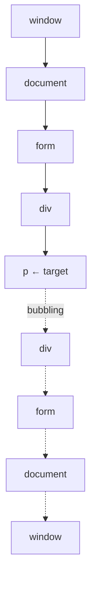

# Browser: DOM събития — фази, delegation, `preventDefault` и passive listeners

https://javascript.info/bubbling-and-capturing
https://javascript.info/event-delegation
https://javascript.info/default-browser-action

## Пътят на едно събитие

Когато потребителят кликне върху бутон, събитието не се случва само на бутона. То пътува през цялото DOM дърво по фиксиран маршрут: от `window` надолу до бутона и после обратно нагоре. По пътя всеки елемент има шанс да реагира. Този маршрут е причината за почти всяко поведение на събитията, което изглежда неочаквано.

Образът е писмо, изпратено до конкретен апартамент в жилищен блок. Пощальонът минава първо през входа, после през етажа и стига до вратата. Това е **capturing фазата**. На вратата писмото се предава на адресата, тоест **target фазата**. После известието, че писмото е пристигнало, се разнася обратно: до етажната площадка, до входа и до целия блок. Това е **bubbling фазата**. Всеки по пътя може да реагира, но най-напред реагира адресатът, защото той знае най-много за писмото.

## Трите фази



**Capturing.** Събитието слиза от корена до целевия елемент. По пътя се изпълняват само listeners, регистрирани с `capture: true`.

**Target.** Събитието стига до най-дълбокия елемент, в който е възникнало. На него се изпълняват listeners и от двете фази.

**Bubbling.** Събитието се връща нагоре до корена. По пътя се изпълняват обикновените listeners. Това е фазата по подразбиране.

```javascript
form.addEventListener('click', onCapture, { capture: true });
form.addEventListener('click', onBubble);
```

Почти всички listeners в практиката са за bubbling фазата. `on<event>` свойствата, HTML атрибутите и `addEventListener` без опции слушат само в target и bubbling фазата. Capturing фазата се използва рядко. Тя е полезна, когато родителят трябва да реагира **преди** децата, например глобален listener, който затваря отворено меню при клик навсякъде извън него.

Два детайла, които често се пропускат. `removeEventListener` трябва да получи **същата стойност на `capture`**, с която е регистриран listener-ът, иначе нищо не се премахва и остава изтичане на памет. Listeners на един и същ елемент и в една и съща фаза се изпълняват в реда, в който са добавени.

### `event.target` срещу `event.currentTarget`

Това е най-честият въпрос за събитията.

**`event.target`** е най-дълбокият елемент, в който е възникнало събитието. Той **не се променя**, докато събитието пътува нагоре.

**`event.currentTarget`**, който в обикновена функция е същото като `this`, е елементът, чийто listener се изпълнява **в момента**. Той се променя на всяка стъпка от маршрута.

```javascript
form.addEventListener('click', (event) => {
  console.log(event.target.tagName);
  console.log(event.currentTarget.tagName);
});
```

При клик върху `<p>` вътре във формата първият ред изписва `P`, а вторият `FORM`. Двете съвпадат само когато кликът е директно върху елемента с listener-а. В arrow функция `this` не е `currentTarget`, затова там винаги се използва `event.currentTarget`.

`event.eventPhase` показва текущата фаза: 1 е capturing, 2 е target и 3 е bubbling.

### Събития, които не правят bubbling

Повечето събития правят bubbling, но не всички. Класическите изключения са `focus` и `blur`, както и `mouseenter` и `mouseleave`. Те имат двойници, които правят bubbling: `focusin` и `focusout`, както и `mouseover` и `mouseout`. Ако delegation не работи за някое събитие, първото, което се проверява, е дали то изобщо прави bubbling. Флагът `event.bubbles` дава отговора.

## Спиране на разпространението

`event.stopPropagation()` спира пътя на събитието към следващите елементи. Другите listeners на **текущия** елемент все пак се изпълняват. `event.stopImmediatePropagation()` спира и тях. Ако `stopPropagation()` се извика в capturing фазата, събитието изобщо не стига до target и bubbling фазата.

javascript.info изрично съветва **да не се спира bubbling без ясна причина**. Проблемът е невидим в момента на писане. Ако вложено меню спре разпространението, глобален listener на `document`, например за аналитика или за затваряне на падащи менюта, никога не вижда кликовете в това меню. Получава се „мъртва зона“, която се открива месеци по-късно и трудно се свързва с причината.

Двете по-добри алтернативи са да се използва `event.defaultPrevented`, описан по-долу, или да се изпрати собствено събитие.

## Event delegation

Event delegation е шаблон, който стъпва директно на bubbling-а. Вместо listener на всяко дете се слага **един listener на общия родител**. В него `event.target` показва кое дете е предизвикало събитието.

```javascript
listingsTable.addEventListener('click', (event) => {
  const row = event.target.closest('tr[data-listing-id]');

  if (!row || !listingsTable.contains(row)) {
    return;
  }

  openListing(row.dataset.listingId);
});
```

Двата помощни метода тук са важни. **`closest(selector)`** тръгва от самия елемент и се изкачва нагоре, докато намери съвпадение. Той е нужен, защото кликът може да е върху `<strong>` или икона вътре в реда, а не върху самия `<tr>`. **`contains`** проверява, че намереният ред е от тази таблица, а не от вложена таблица в нея.

Шаблонът може да се разшири с `data-action` атрибути. Един listener на контейнера чете `event.target.closest('[data-action]').dataset.action` и извиква съответния метод. Така поведението се добавя чрез маркъп, без нов JavaScript за всеки бутон.

**Ползите.** По-малко listeners означава по-малко памет и по-проста инициализация. Елементи, добавени по-късно, например при безкрайно скролиране или чрез `innerHTML`, се обработват автоматично, без да се регистрира нищо за тях.

**Ограниченията.** Събитието трябва да прави bubbling, затова `focus` не работи, а `focusin` работи. Никое дете не трябва да вика `stopPropagation()`, иначе delegation-ът се чупи тихо. Listener-ът на контейнера се изпълнява за всяко събитие в поддървото му, но това натоварване обикновено е пренебрежимо.

## `preventDefault` срещу `stopPropagation`

Това са два напълно различни механизма, които често се бъркат.

| | `stopPropagation()` | `preventDefault()` |
|---|---|---|
| Какво спира | пътя на събитието към другите елементи | действието на браузъра по подразбиране |
| Другите listeners | не се изпълняват по-нататък по пътя | изпълняват се нормално |
| Пример | клик в менюто не стига до `document` | линкът не навигира, формата не се изпраща |

Действия по подразбиране са например навигация при клик на `<a href>`, изпращане на форма, превключване на checkbox, селектиране на текст при `mousedown`, въвеждане на символ при `keydown`, контекстно меню при десен бутон и скролиране при `wheel` и `touchmove`.

`return false` спира действието **само** в `on<event>` handlers. В `addEventListener` върнатата стойност се игнорира, затова там винаги се използва `preventDefault()`.

Някои събития предизвикват следващи. Ако се отмени първото, отменя се и веригата. Например отменен `mousedown` върху поле не дава фокус при клик, но Tab продължава да работи.

### `event.defaultPrevented` вместо `stopPropagation`

javascript.info показва класически пример. Бутон има собствено контекстно меню, а документът има свое. Без намеса при десен клик върху бутона се появяват и двете, защото събитието прави bubbling. Лошото решение е `stopPropagation()` в бутона. То работи, но създава мъртва зона за всеки друг код по-нагоре. Доброто решение е събитието да продължи, а горните listeners да проверят дали някой вече го е обработил:

```javascript
button.addEventListener('contextmenu', (event) => {
  event.preventDefault();
  showButtonMenu();
});

document.addEventListener('contextmenu', (event) => {
  if (event.defaultPrevented) {
    return;
  }

  event.preventDefault();
  showDocumentMenu();
});
```

`defaultPrevented` превръща `preventDefault()` в сигнал „вече е обработено“, който всеки по-нагоре може да прочете, без събитието да изчезва.

## Passive listeners

При `touchstart`, `touchmove` и `wheel` действието по подразбиране е **скролиране**. Браузърът не знае предварително дали някой listener няма да извика `preventDefault()` и да го отмени. Затова при обикновен listener той **изчаква** listener-ът да приключи, преди да скролира. Ако listener-ът е бавен, скролирането засича.

Опцията `passive: true` е обещание, че listener-ът **никога** няма да извика `preventDefault()`. Тогава браузърът скролира веднага, паралелно с изпълнението на listener-а.

```javascript
gallery.addEventListener('touchmove', onTouchMove, { passive: true });
```

Ако passive listener все пак извика `preventDefault()`, извикването се игнорира, а браузърът изписва предупреждение в конзолата. Chrome и Firefox вече третират `touchstart` и `touchmove` на `window`, `document` и `body` като passive по подразбиране. Ако кодът наистина трябва да спре скролирането, например при собствен жест за плъзгане, трябва изрично да се зададе `passive: false`.

Връзката с [[browser-event-loop]] е директна. Скролирането се усеща гладко само ако main thread-ът не го блокира. Passive listener-ът премахва зависимостта на скролирането от JavaScript.

### Другите опции на `addEventListener`

Освен `capture` и `passive` има още две полезни опции. Те не са в изворните статии на javascript.info, а са от MDN.

`once: true` премахва listener-а автоматично след първото изпълнение.

`signal` приема `AbortSignal` от `AbortController`. Когато се извика `controller.abort()`, всички listeners, регистрирани с този signal, се премахват наведнъж. Това решава проблема с `removeEventListener`, при който трябва да се пази референция към точно същата функция и същата стойност на `capture`.

```javascript
const controller = new AbortController();

window.addEventListener('resize', onResize, { signal: controller.signal });
window.addEventListener('scroll', onScroll, { signal: controller.signal, passive: true });

controller.abort();
```

## Събитията в Angular

**Event binding в темплейта**, тоест `(click)="..."`, регистрира listener директно на конкретния елемент, в bubbling фазата. Angular не прави delegation по подразбиране. Затова в голям списък с `(click)` на всеки ред има по един listener на ред. Обикновено това не е проблем, но при хиляди редове delegation на контейнера, с `closest` и `data-*` атрибути, е по-лекото решение.

**Host listeners** с `host: { '(document:click)': '...' }` слушат на глобални цели. Това е естественото място за затваряне на меню при клик извън него, а `event.target` се сравнява с host елемента чрез `contains`. Свойството `host` е описано в [[angular-content-projection-queries]].

**Outputs не правят bubbling.** Собствените събития на компонентите, описани в [[angular-inputs-outputs-model]], не са DOM събития и стигат само до прекия родител. Това е честа изненада за хора, свикнали с DOM. Ако събитие на Angular компонент трябва да мине през няколко нива, всяко ниво трябва да го препредаде, или комуникацията трябва да мине през споделен service.

**Change detection.** Със Zone.js `addEventListener` е обвит, затова **всяко** DOM събитие, дори `mousemove`, пуска change detection. Затова честите събития се регистрират в `NgZone.runOutsideAngular`, описано в [[browser-event-loop-angular]]. В zoneless приложение само listeners от темплейта и от `host` известяват Angular. Listener, добавен ръчно с `addEventListener`, не пуска change detection.

**Passive в Angular.** Синтаксисът на темплейта няма модификатор за passive. Когато трябва passive listener за `touchmove` или `wheel`, той се регистрира ръчно с `addEventListener` и `{ passive: true }`. Най-добре е това да стане в `afterNextRender`, за да не се изпълнява при SSR, и да се премахне с `DestroyRef`. Тази препоръка е мой извод, а не от документацията.

**`dispatchEvent` е синхронен.** Събитие, изпратено от кода с `element.dispatchEvent(new CustomEvent('x', { bubbles: true }))`, изпълнява всички listeners **синхронно**, преди `dispatchEvent` да върне контрола. Събитие от потребителя обаче е макрозадача в [[browser-event-loop]]. Затова, ако собствено събитие трябва да се изпрати след като текущото е напълно обработено, то се изпраща в `setTimeout`. Собствено събитие прави bubbling само ако е създадено с `bubbles: true`.

## Изречението за интервю

> Всяко DOM събитие минава през три фази: capturing от корена надолу, target на елемента и bubbling обратно нагоре. Listeners по подразбиране са в bubbling фазата. `event.target` е елементът, в който е възникнало събитието, и не се променя, а `currentTarget` е елементът, чийто listener се изпълнява в момента. Bubbling-ът прави възможно event delegation: един listener на контейнера, `closest` за намиране на елемента и автоматична работа с добавени по-късно елементи. Само събития като `focus` и `mouseenter` не правят bubbling. `stopPropagation` спира пътя на събитието и създава мъртви зони за глобални listeners, затова предпочитам `preventDefault` с проверка на `defaultPrevented`. `preventDefault` спира действието на браузъра, а не разпространението. `passive: true` обещава, че няма да има `preventDefault`, и позволява на браузъра да скролира веднага. В Angular outputs не правят bubbling, а със Zone.js всяко DOM събитие пуска change detection, затова честите събития отиват в `runOutsideAngular`.
