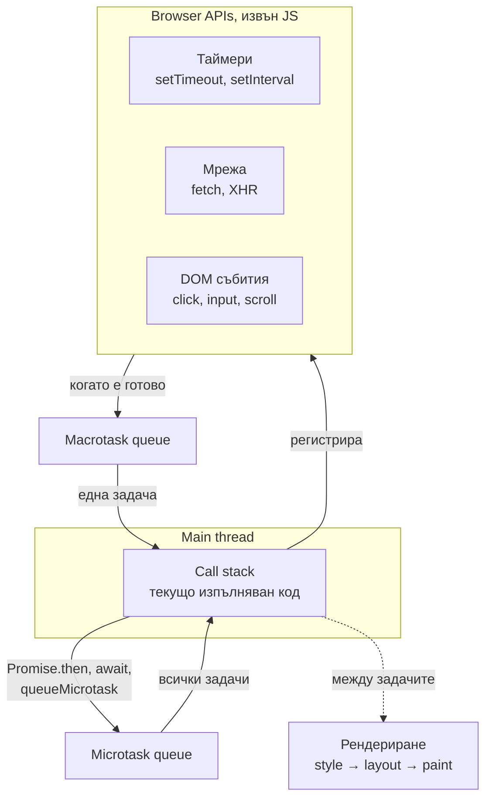
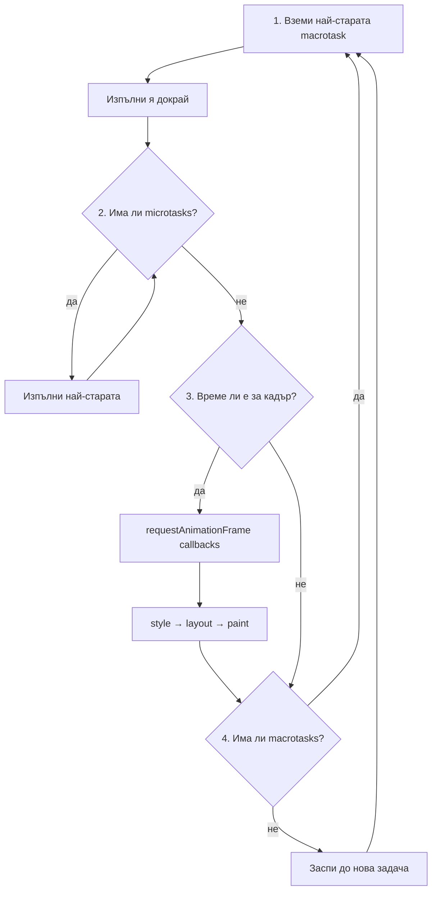

# Browser: Event loop — macrotasks, microtasks и рендериране

https://javascript.info/event-loop
https://javascript.info/microtask-queue

## Основната идея: един поток и безкраен цикъл

JavaScript в браузъра се изпълнява в **един поток**, наречен main thread. В него едновременно се изпълнява само едно парче код. В същия поток браузърът изчислява стиловете, layout-а и рисува страницата. Всичко останало, което изглежда паралелно, като таймери, мрежови заявки и събития от мишката, се случва извън JavaScript. Браузърът го следи сам и когато има резултат, поставя **задача** на опашка.

Event loop-ът е безкрайният цикъл, който свързва двете страни. Той взима задача от опашката и я изпълнява докрай. После изпълнява всички микрозадачи, рисува, ако има какво, и заспива, докато не се появи нова задача. През по-голямата част от времето JavaScript engine-ът не прави нищо и почти не натоварва процесора.

Образът е готвач в малка кухня с един котлон. На котлона може да се готви само едно ястие наведнъж. Поръчките пристигат на гишето и се нареждат на опашка: кликове, изтекли таймери, отговори от сървъра. Готвачът взима поръчка, приготвя я докрай и чак тогава поглежда гишето отново. Сервитьорът носи готовото към залата, тоест рисува страницата, само между две поръчки, никога по средата на готвене. Таймерите и мрежата са помощници извън кухнята. Те не готвят, а само оставят нови поръчки на гишето, когато дойде времето им.

## Архитектурата в една схема



**Call stack** е стекът от функции, които се изпълняват в момента. Докато не е празен, нищо друго не може да се изпълни.

**Browser APIs** са механизмите извън JavaScript. `setTimeout` не брои времето в JavaScript. Той казва на браузъра „след 100 ms постави тази функция на опашката“ и веднага връща контрола. Същото правят `fetch` и `addEventListener`.

**Macrotask queue** е опашката на „големите“ задачи. В практиката браузърите имат няколко такива опашки с различен приоритет, например за потребителско въвеждане и за таймери. За Senior ниво е достатъчно да се мисли за тях като за една опашка.

**Microtask queue** е отделна опашка за микрозадачите. Тя се изпразва изцяло след всяка макрозадача.

## Алгоритъмът стъпка по стъпка



1. Вземи **една** макрозадача, най-старата, и я изпълни докрай.
2. Изпълни **всички** микрозадачи. Ако някоя микрозадача добави нова микрозадача, тя също се изпълнява в същия цикъл, преди да се продължи.
3. Ако е време за нов кадър, изпълни callback-ите на `requestAnimationFrame` и после рендерирай промените. Обикновено това е около 60 пъти в секунда, тоест на всеки около 16 ms.
4. Върни се към стъпка 1 или заспи, ако няма задачи.

Асиметрията между стъпка 1 и стъпка 2 е най-важното в целия файл. От макрозадачите се взима **само една** на цикъл. Микрозадачите се изпълняват **всички**, докато опашката се изпразни.

Стъпката с `requestAnimationFrame` и подробностите за рендерирането не са в изворната статия на javascript.info, която описва рендерирането само като „рисувай промените, ако има такива“. Те идват от спецификацията на HTML и от общоприетия модел на браузърите.

## Кое е macrotask и кое е microtask

**Macrotasks** идват от браузъра, от външния свят:

- изпълнението на `<script>`
- callback на `setTimeout` и `setInterval`
- DOM събития като `click`, `input` и `scroll`
- `MessageChannel` и `postMessage`
- отговорът от мрежова операция като `fetch`, който всъщност резолвва Promise. Самата обработка в `.then` е микрозадача.

**Microtasks** идват изцяло от твоя код:

- `.then`, `.catch` и `.finally` на Promise
- продължението след `await`, защото `await` е друга форма на `.then`
- `queueMicrotask(fn)`
- callback-ите на `MutationObserver`

## Защо има две опашки

Микрозадачите гарантират, че **средата е стабилна** между тях. Докато опашката с микрозадачи се изпразва, браузърът не обработва кликове, не получава нови данни от мрежата и не рисува. Ако една верига от `.then` променя DOM на няколко стъпки, потребителят никога няма да види междинно, недовършено състояние. Всички стъпки виждат и един и същ свят: същите координати на мишката и същото състояние на страницата.

Макрозадачите обратно дават на браузъра **възможност да диша**. Между две макрозадачи той може да нарисува кадър и да обработи клик.

Оттук идва и практическото правило за избор:

- **`queueMicrotask` или `Promise.resolve().then`**: „изпълни след текущия код, но преди браузърът да направи каквото и да е друго.“
- **`setTimeout(fn)` или `setTimeout(fn, 0)`**: „изпълни след текущия код, но остави браузъра първо да рисува и да обработи събития.“
- **`requestAnimationFrame(fn)`**: „изпълни точно преди следващото рисуване.“ Това е правилното място за визуални промени и анимации.

## Редът на изпълнение: класическият въпрос

Типичният въпрос на интервю е код със смесени синхронни, микро- и макрозадачи и въпрос в какъв ред ще се изпише резултатът.

```javascript
console.log('A');

setTimeout(() => console.log('B'));

Promise.resolve().then(() => {
  console.log('C');
  setTimeout(() => console.log('D'));
  queueMicrotask(() => console.log('E'));
});

(async () => {
  console.log('F');
  await null;
  console.log('G');
})();

console.log('H');
```

Резултатът е **A F H C G E B D**. Разсъждението върви по фазите.

**Синхронният код** се изпълнява пръв, докрай. Изписват се `A`, после `F`, защото тялото на `async` функция до първия `await` е синхронно, после `H`. Междувременно на опашките са сложени: макрозадача `B`, микрозадача с `C` и микрозадача с продължението след `await`, тоест `G`.

**Микрозадачите** се изпълняват всички, в реда на поставяне. Изписва се `C`. Докато се изпълнява, тя поставя макрозадача `D` след `B` и нова микрозадача `E` в края на микроопашката. После се изписва `G`. После се изписва `E`. Тя е добавена по време на изпразването, но се изпълнява в същия цикъл, защото микроопашката се изпразва изцяло.

**Макрозадачите** се изпълняват по една: `B`, после `D`.

Ключът е, че `await` разделя `async` функцията на две части. Всичко преди него е синхронно, а всичко след него е микрозадача.

## Рендерирането никога не прекъсва задача

Браузърът рисува само **между** задачите, никога по средата. Ако една функция променя DOM хиляда пъти, потребителят вижда само крайния резултат.

Това има две страни. Добрата е, че потребителят никога не вижда полуготов UI. Лошата е, че дълга задача **замразява** страницата: няма рисуване, бутоните не реагират, анимациите спират. Ако задачата продължи твърде дълго, браузърът предлага да спре страницата. Задача над 50 ms се нарича **long task**. Тя е основната причина за лош INP, Core Web Vitals метриката за отзивчивост.

## Гладуване на рендерирането от микрозадачи

От асиметрията на алгоритъма следва един коварен капан. Микрозадачите се изпълняват всички, включително новодобавените. Затова безкрайна верига от микрозадачи **никога не стига до рендериране**.

```javascript
function loop() {
  queueMicrotask(loop);
}
loop();
```

Този код замразява страницата толкова сигурно, колкото `while (true)`, макар формално да е „асинхронен“. Същото важи за Promise, който рекурсивно резолвва нов Promise. Ако същата функция използва `setTimeout`, страницата остава жива, защото между две макрозадачи браузърът рисува и обработва събития.

## Как се разделя тежка задача

Ако трябва да се изпълни тежко изчисление, например обработката на хиляди елементи, решението е да се раздели на парчета, всяко като **отделна макрозадача**. Между парчетата браузърът рисува и обработва кликове.

```javascript
function processChunk(items, start = 0) {
  const end = Math.min(start + 500, items.length);

  for (let i = start; i < end; i++) {
    process(items[i]);
  }

  if (end < items.length) {
    setTimeout(() => processChunk(items, end));
  }
}
```

Два детайла. Първият е, че браузърът налага минимално закъснение от около 4 ms за вложени `setTimeout`, след няколко нива на влагане. Затова е по-бързо следващото парче да се планира в началото на функцията, а не в края. Вторият е, че с `queueMicrotask` вместо `setTimeout` разделянето **не помага**. Всички парчета се изпълняват в един цикъл, без рендериране между тях, по правилото от предишния раздел.

Ако изчислението изобщо не засяга DOM, по-доброто решение е **Web Worker**. Той изпълнява код в отделен поток, със собствен event loop и без достъп до DOM. Комуникира с main thread-а чрез съобщения.

## Отлагане след края на събитието

`setTimeout` с нулево закъснение се използва и в event handler, когато нещо трябва да се случи **след** като текущото събитие е напълно обработено. Тоест след като е минало bubbling-а през всички родителски елементи и всички handlers са изпълнени. Пример е изпращане на собствено събитие, което не трябва да се смесва с текущия клик.

## Неприхванатите Promise грешки и микроопашката

Събитието `unhandledrejection`, споменато в [[rxjs-error-handling]], също е свързано с микроопашката. Браузърът проверява за отхвърлени Promise без `.catch` **в края на изпразването на микроопашката**. Ако `.catch` бъде добавен по-късно, например в `setTimeout`, събитието вече е изпратено. Грешката се отчита като неприхваната, макар после да бъде обработена.

## Сравнение на начините за планиране

| Механизъм | Опашка | Кога се изпълнява | Блокира ли рендерирането | Типична употреба |
|---|---|---|---|---|
| синхронен код | call stack | веднага | да, докато не свърши | обикновена логика |
| `queueMicrotask`, `.then`, `await` | microtask | след текущия код, преди всичко друго | да, ако веригата е безкрайна | продължение в същото „състояние на света“ |
| `requestAnimationFrame` | преди рендериране | веднъж преди следващия кадър | не | анимации, визуални промени |
| `setTimeout(fn)` | macrotask | в следващ цикъл, след рендериране | не | разделяне на тежка работа, отлагане след събитие |
| Web Worker | отделен поток | паралелно | не | тежки изчисления без DOM |

## Изречението за интервю

> JavaScript в браузъра се изпълнява в един поток. Event loop-ът взима една макрозадача, като скрипт, таймер или DOM събитие, изпълнява я докрай и после изпълнява всички микрозадачи: Promise handlers, продълженията след `await` и `queueMicrotask`. Едва тогава браузърът може да рисува и да вземе следващата макрозадача. Затова микрозадача винаги се изпълнява преди `setTimeout`, а рендерирането никога не прекъсва задача. Дълга задача замразява UI, затова тежката работа се дели на макрозадачи със `setTimeout` или се изнася в Web Worker. Безкрайна верига от микрозадачи е толкова опасна, колкото безкраен цикъл, защото рендерирането никога не идва.
