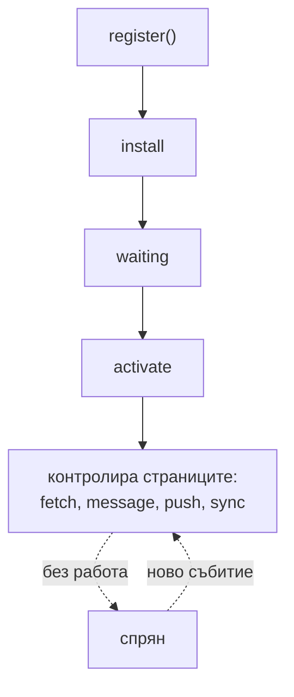

# Browser: Service Worker и Angular Service Worker

https://developer.mozilla.org/en-US/docs/Web/API/Service_Worker_API
https://angular.dev/ecosystem/service-workers
https://angular.dev/ecosystem/service-workers/config
https://angular.dev/ecosystem/service-workers/devops
https://angular.dev/ecosystem/service-workers/communications

## Действащите лица

**Румяна** е Angular SPA приложението. Тя живее в main thread-а на таба, изпраща HTTP заявки една след друга и иска отговорите веднага. **Пламен** е Service Worker-ът. Той е пазачът на портата между домакинството и външния свят. Всяка заявка, която Румяна изпраща навън, минава първо през него, и той решава дали да я пусне към мрежата, да отговори от собствената си тетрадка или да състави отговор сам.

Без Пламен всяка заявка на Румяна зависи изцяло от мрежата. Всяко извикване на API е пълен път до сървъра и обратно. Без интернет заявката завършва с `HttpErrorResponse` със статус 0 и функционалността показва грешка или празен екран. Кешът в паметта, например чрез `shareReplay` от [[rxjs-sharereplay-hot-cold]], изчезва при всяко презареждане на страницата.

## Какво е Service Worker

Service Worker е JavaScript файл, който браузърът изпълнява **отделно от страницата**, в собствен глобален контекст `ServiceWorkerGlobalScope`, а не `Window`. Той няма `document` и `window` и няма достъп до DOM. Вместо тях има `self`, `fetch`, `caches`, `clients` и `registration`. Подобно на Web Worker, описан в [[browser-event-loop]], той има собствен event loop и не блокира main thread-а на страницата.

Най-точното описание е, че Service Worker е **програмируем мрежов слой с жизнен цикъл**. Той съчетава четири роли:

- **proxy**, който прихваща мрежовите заявки на контролираните страници
- **контролер на кеша**, който програмно решава какво да пази, колко дълго и кога да го изхвърли
- **слушател на събития**, който реагира на `install`, `activate`, `fetch`, `message`, `push` и `sync`
- **worker със собствен жизнен цикъл**, с версии и правила за обновяване, независими от страницата

Разликата спрямо библиотека за кеширане е, че Service Worker-ът е цял мрежов слой, който разработчикът контролира програмно.

### Ограниченията

Service Worker работи **само по HTTPS**, с изключение на `localhost` за разработка. Причината е, че той може да подменя всеки отговор, затова браузърът трябва да е сигурен, че самият файл не е подменен по пътя.

Обхватът (scope) се определя от мястото на файла. Worker в `/ngsw-worker.js` в корена контролира целия сайт. Worker в `/app/sw.js` контролира само пътищата под `/app/`.

Браузърът може да **спре** worker-а по всяко време, когато няма работа, и да го стартира отново при следващо събитие. Затова състоянието му не може да живее в глобални променливи. Всичко, което трябва да оцелее, се пази в `CacheStorage` или в `IndexedDB`.

## Жизненият цикъл



### Регистрация

Страницата извиква `navigator.serviceWorker.register('/ngsw-worker.js')`. Браузърът изтегля файла, проверява синтаксиса и започва инсталацията, но **не прихваща заявките на текущото зареждане**. Затова при първото посещение на нов потребител всички заявки минават през мрежата без участието на Service Worker-а. Worker-ът започва да контролира страниците от следващото зареждане, освен ако не извика `clients.claim()`. Това често обърква при тестване.

### Install

Събитието `install` е моментът, в който worker-ът подготвя всичко нужно, за да работи офлайн. Обикновено той отваря кеш и записва в него app shell-а: `index.html`, основните bundles, стиловете и шрифтовете. С `event.waitUntil(promise)` worker-ът казва на браузъра да изчака promise-а. Ако той бъде отхвърлен, например защото един ресурс не се е изтеглил, цялата инсталация се проваля. Така инсталацията е атомарна: или всичко е в кеша, или нищо.

### Waiting

След инсталацията новият worker **чака**, ако вече има активен стар worker. Той не поема контрол, докато всички табове, контролирани от стария, не бъдат затворени. Простото презареждане на таба не стига, защото при него за момент има и стара, и нова страница.

Причината е защитата от **split brain**. Нека в таб A е отворена версия 1 на приложението и бъде качена версия 2. Ако новият worker веднага поеме контрол, кодът на версия 1 в таб A започва да получава ресурси на версия 2. Например lazy chunk-ове със съвсем други имена. Резултатът са грешки при зареждане на chunk-ове и счупено приложение.

`self.skipWaiting()` прескача изчакването и активира новия worker веднага. Това е безопасно само ако worker-ът сам гарантира, че старите табове продължават да получават ресурсите на своята версия. Точно така работи Angular Service Worker-ът, описан по-долу.

### Activate

Събитието `activate` е мястото за почистване на кешовете на старите версии. Тук може да се извика и `self.clients.claim()`: worker-ът поема контрол над вече отворените страници в своя обхват веднага, без презареждане. Без `clients.claim()` новият worker контролира само страниците, отворени след активирането му.

## Прихващането на заявки: събитието `fetch`

Всяка заявка от контролирана страница предизвиква събитие `fetch` в worker-а. Това включва навигациите, тоест самия HTML, API заявките, изображенията, шрифтовете, стиловете и динамичните `import()`, чрез които Angular зарежда lazy routes. Прихващат се и заявки към други домейни. За заявка с режим `no-cors` обаче worker-ът получава **opaque** отговор, чиито статус и съдържание не може да прочете.

Решението се взима с `event.respondWith(promise)`. Promise-ът трябва да се резолвва до обект `Response`. Ако worker-ът не извика `respondWith`, браузърът изпълнява заявката нормално, все едно worker-ът го няма.

Пламен може да върне отговор от три източника:

- **от кеша**: `caches.match(request)` връща готов `Response` от `CacheStorage`
- **от мрежата**: `fetch(request)` връща пресен отговор, който може и да се запише в кеша
- **синтетичен отговор**: `new Response(body, { status, headers })` е изцяло съставен от worker-а, например офлайн страница или JSON с грешка

## Стратегиите за кеширане

Комбинациите от тези три източника дават стандартните стратегии.

**Cache first.** Ако отговорът е в кеша, връща се веднага. Ако не е, изпраща се заявка, резултатът се кешира и се връща. Пламен казва: „Имам ли го в тетрадката? Давам веднага. Ако нямам, тичам и си го записвам за следващия път.“ Подходящо е за неща, които рядко се променят: номенклатури, списъци с градове, версионирани статични ресурси.

**Network first.** Първо се опитва мрежата, по възможност с ограничение на времето. При успех резултатът се връща и се кешира. При грешка или изтекло време се връща кешът. Пламен казва: „Първо ще проверя на улицата. Ако куриерът закъснее повече от три секунди или изобщо не дойде, давам от тетрадката.“ Подходящо е за данни, при които свежестта е важна, но остаряла стойност е по-добра от грешка.

**Stale-while-revalidate.** Кешът се връща веднага, а паралелно се изпраща заявка, чийто резултат обновява кеша за следващия път. Потребителят вижда старото сега и новото при следващото поискване. Това е най-добрият потребителски опит за данни, които се четат често.

**Cache only** и **network only** са крайните случаи. Първото е за ресурси, гарантирано изтеглени при install. Второто е за заявки, които никога не трябва да се кешират, като плащания и записи.

| Стратегия | Скорост | Свежест | Офлайн | Типичен случай |
|---|---|---|---|---|
| Cache first | Най-висока | Ниска | Да | Версионирани статични ресурси, номенклатури |
| Network first | Зависи от мрежата | Висока | Да, с остаряли данни | Потребителски данни, статуси |
| Stale-while-revalidate | Висока | Със закъснение от една заявка | Да | Често четени данни |
| Network only | Зависи от мрежата | Пълна | Не | Записи, плащания |

## `CacheStorage` срещу `IndexedDB`

| | `CacheStorage` | `IndexedDB` |
|---|---|---|
| Модел | HTTP-подобен | база данни с транзакции |
| Ключ | обект `Request` | произволен: низ, число и други |
| Стойност | обект `Response` | произволни JavaScript обекти |
| Търсене | съвпадение по заявка | индекси, курсори, диапазони |
| Типична употреба | кеш на HTTP отговори | структурирани данни, офлайн състояние |

`CacheStorage` е естественото място за мрежови отговори. `IndexedDB` е мястото за структурирани данни на приложението, например офлайн чернови на форми, които после се изпращат. Удобни обвивки за `IndexedDB` са библиотеките `idb` и `Dexie`. И двете хранилища са общи за страницата и за worker-а и попадат в квотата на браузъра за origin-а.

## Angular Service Worker

Angular предоставя готов Service Worker в пакета `@angular/service-worker`. Разработчикът не пише собствени handlers за `install` и `fetch`, а описва поведението декларативно във файла `ngsw-config.json`.

При production build Angular CLI генерира **`ngsw.json`**. Това е манифест с хешове на всички ресурси от конфигурацията. Ако дори един байт от ресурс се промени, хешът му се променя и worker-ът разбира, че има нова версия. Самият `ngsw-worker.js` е общ за всички Angular приложения. Цялата специфична конфигурация живее в `ngsw.json`.

Кешират се само заявки, които не променят данни, тоест `GET` и `HEAD`.

### `assetGroups`: app shell и статичните ресурси

```json
{
  "name": "app",
  "installMode": "prefetch",
  "updateMode": "prefetch",
  "resources": {
    "files": ["/index.html", "/*.css", "/*.js"]
  }
}
```

`installMode` определя кога ресурсите влизат в кеша първия път. При `prefetch` всичко се изтегля предварително, още при инсталацията. Това гарантира, че приложението може да стартира офлайн. При `lazy` ресурсът се кешира едва когато бъде поискан, което е подходящо за рядко използвани ресурси като големи изображения. Стойността по подразбиране е `prefetch`.

`updateMode` определя какво става с вече кеширан ресурс, когато излезе нова версия. При `prefetch` променените ресурси се изтеглят веднага, а при `lazy` едва при следващото поискване. Стойността по подразбиране е същата като на `installMode`, а `lazy` е валиден само ако и `installMode` е `lazy`.

`resources.files` описва файлове от build-а, които имат хешове в манифеста. `resources.urls` описва адреси, например от CDN, които се кешират без проверка на хеша. За тях worker-ът използва stale-while-revalidate и спазва HTTP хедърите за кеширане.

### `dataGroups`: API заявките

```json
{
  "name": "listings-api",
  "urls": ["/api/listings/**"],
  "cacheConfig": {
    "strategy": "freshness",
    "maxSize": 100,
    "maxAge": "1h",
    "timeout": "3s"
  }
}
```

`strategy` приема две стойности. **`performance`** е стойността по подразбиране и съответства на cache first: ако отговорът е в кеша, той се връща без заявка към мрежата, а остарелостта се търпи до `maxAge`. **`freshness`** съответства на network first: предпочита се мрежата, а кешът се използва, ако мрежата не отговори в рамките на `timeout`.

Останалите параметри са следните. `maxSize` е максималният брой кеширани отговори. При препълване най-старите се изхвърлят. `maxAge` е колко дълго кешираният отговор е валиден. Задава се с наставки като `d`, `h`, `m` и `s`. `timeout` е колко да се чака мрежата, преди да се върне кешът. `refreshAhead` задава колко време преди изтичане кешираният отговор да се обнови проактивно от мрежата. `cacheOpaqueResponses` определя дали да се кешират opaque отговори от други домейни. По подразбиране е `true` за `freshness` и `false` за `performance`. `version` е цяло число и промяната му изхвърля всички стари записи на групата. Това е полезно, когато форматът на API отговорите се промени несъвместимо.

### Липсващата стратегия stale-while-revalidate

`dataGroups` нямат директна стратегия stale-while-revalidate. Тя е налична в Workbox, библиотеката на Google за Service Workers, и може да се напише ръчно в собствен worker. В Angular най-близките приближения са две. Първото е `performance` с `refreshAhead`, при което кешът се обновява от мрежата малко преди да изтече. Второто е `freshness` с много кратък `timeout`. Второто приближение разчита на поведение, което не е описано в текущата документация, затова трябва да се провери, преди да се използва.

### Навигации и SSR

Навигационните заявки, тоест зареждането на страница по URL, се обслужват по подразбиране от кеширания `index.html`. Това се определя от `navigationRequestStrategy: "performance"`. По подразбиране за навигации се смятат всички адреси без файлово разширение в последния сегмент. Стойността `freshness` изпраща навигациите към мрежата и се връща към кеша само офлайн.

Този детайл е важен при SSR. При `performance` повторното посещение получава кеширания клиентски `index.html`, а не прясно рендерирания от сървъра HTML. За приложение със SSR, при което сървърният HTML носи съдържание или правилни статус кодове, `freshness` често е по-подходящият избор. Това е извод от поведението на двете стратегии, а не изрична препоръка на документацията.

## Как Angular управлява версиите

Тук Angular решава проблема със split brain по свой начин. Вместо да разчита на фазата waiting, той **пази няколко версии на приложението едновременно** и закрепва всеки таб към версията, с която е стартирал. Отвореният таб продължава да получава ресурсите на своята версия, включително lazy chunk-овете ѝ. Новият таб получава най-новата версия. Кешът на дадена версия се изтрива, когато вече нито един таб не я използва.

Доколкото е известно от изходния код на `ngsw-worker.js`, Angular worker-ът извиква `skipWaiting()` при инсталация и `clients.claim()` при активиране. Именно закрепването на табовете към версии прави това безопасно. Документацията на Angular не описва тези две извиквания.

Проверката за нова версия става при всяко отваряне или презареждане на приложението. Worker-ът изтегля `ngsw.json` и ако хешовете са различни, изтегля и кешира новата версия във фонов режим. Тя се използва при следващото зареждане.

### Цялост на ресурсите

Всеки ресурс от `ngsw.json` се проверява срещу хеша си. Ако проверката не мине, worker-ът изтегля файла отново, с параметър, който заобикаля междинните кешове. Ако и тогава хешът не съвпада, цялата версия се смята за невалидна и не се сервира. Типичните причини са остарели междинни кешове, неатомарен deploy и грешки в build-а.

### Деградиралите състояния

Worker-ът може да влезе в две временни състояния. При `EXISTING_CLIENTS_ONLY` няма чисто копие на най-новата версия. Отворените табове продължават със старата си версия, а новите зареждания отиват към мрежата. При `SAFE_MODE` кешираните данни не могат да се смятат за сигурни, затова целият трафик минава през мрежата. И двете състояния траят само докато живее текущата инстанция на worker-а.

### `SwUpdate`

Service-ът `SwUpdate` свързва приложението с механизма на версиите. Потокът `versionUpdates` излъчва четири вида събития:

- `VERSION_DETECTED`: открита е нова версия и изтеглянето ѝ започва
- `NO_NEW_VERSION_DETECTED`: проверката не е открила нова версия
- `VERSION_READY`: новата версия е изтеглена и готова за активиране
- `VERSION_INSTALLATION_FAILED`: инсталацията на новата версия се е провалила

`checkForUpdate()` изрично пита worker-а за нова версия и връща `Promise<boolean>`. Promise-ът се отхвърля при неуспешна проверка, затова извикването се обвива в `try/catch`. `activateUpdate()` превключва текущия таб към новата версия без презареждане. Документацията предупреждава, че това може да счупи приложението. App shell-ът от старата версия може да поиска lazy chunk, чието име в новата версия е различно. Затова препоръчителният подход е да се попита потребителят и при съгласие страницата да се презареди.

```typescript
export class AppUpdates {
  private readonly swUpdate = inject(SwUpdate);

  constructor() {
    this.swUpdate.versionUpdates
      .pipe(
        filter((event): event is VersionReadyEvent => event.type === 'VERSION_READY'),
        takeUntilDestroyed(),
      )
      .subscribe(() => {
        if (confirm($localize`Има нова версия. Да презаредим ли страницата?`)) {
          document.location.reload();
        }
      });
  }
}
```

Потокът `unrecoverable` излъчва, когато табът не може да бъде поправен без пълно презареждане. Типичният пример е, че браузърът е изтрил lazy chunk от кеша, а новият deploy е премахнал старата версия от сървъра. Тогава worker-ът не може нито да сервира chunk-а, нито да го изтегли. Правилната реакция е да се уведоми потребителят и да се поиска презареждане.

### Периодична проверка и стабилността на приложението

Ако приложението проверява за нови версии периодично, проверката не трябва да започва веднага. `setInterval` или `interval` от RxJS държат приложението нестабилно. Това е същият механизъм, описан в [[browser-event-loop-angular]] за SSR. По подразбиране Angular регистрира worker-а едва когато приложението стане стабилно, затова безкраен таймер при стартиране може да забави регистрацията до 30 секунди. Документацията препоръчва проверките да започнат след първото `ApplicationRef.isStable`.

## Поддръжка в production

**Debugging.** Страницата `/ngsw/state` показва състоянието на worker-а, хеша на последния манифест, кешираните версии и кои табове ги използват, както и журнал. В Chrome DevTools раздел Application показва жизнения цикъл на worker-а и съдържанието на `CacheStorage`. Там има и опции за принудително обновяване и офлайн режим. В раздел Network отговорите, сервирани от worker-а, са отбелязани с `(ServiceWorker)`. Отвореният DevTools държи worker-а жив, а изгледът на `CacheStorage` може да е остарял и трябва да се опресни ръчно.

**Заобикаляне на worker-а.** Хедър или query параметър `ngsw-bypass`, с произволна стойност, изпраща заявката директно към мрежата. Това е полезно за функционалности, които worker-ът не поддържа, например прогрес при качване на файл.

**Аварийно изключване.** Ако worker-ът трябва да бъде махнат, има два механизма. Първият е fail-safe: ако `ngsw.json` върне 404, worker-ът изчиства кешовете си и се отрегистрира. Вторият е `safety-worker.js` от `@angular/service-worker`. Той се сервира на адреса на стария worker и при следващата проверка за обновяване изтрива кешовете и отрегистрира worker-а. Не се регистрира директно и се препоръчва да остане на този адрес за постоянно.

**Пренасочвания и хедъри.** Service Worker не работи зад пренасочване, затова преместването на приложението на нов адрес може да остави стария worker неработещ. Промяна само на HTTP хедъри, например CSP, не преинсталира worker-а. За това се регистрира адрес с версия, например `ngsw-worker.js?v=2`.

## Отвъд кеширането

**Комуникация с приложението.** Страницата изпраща съобщение на worker-а с `navigator.serviceWorker.controller?.postMessage(...)`. Worker-ът отговаря на конкретния таб с `event.source.postMessage(...)` в handler-а на `message`. За заявка с отговор се използва `MessageChannel`. Angular скрива тази комуникация зад `SwUpdate` и `SwPush`.

**Push известия.** Сървърът може да събуди worker-а и да покаже известие, дори когато табът на приложението е затворен. Потокът е следният. Приложението иска разрешение от потребителя. После се абонира към push услугата на браузъра и получава endpoint и ключове. Изпраща ги на собствения backend. Backend-ът изпраща съобщение към push услугата, тя събужда worker-а със събитие `push`, а той показва известие със `self.registration.showNotification()`. Самият браузър трябва да е стартиран, поне във фонов режим. В Angular това се прави чрез `SwPush`. Пример за ипотечна платформа е известие при смяна на статуса на кандидатура или при нов документ за преглед.

**Background Sync.** Заявка, направена офлайн, се регистрира с таг чрез `registration.sync.register('submit-application')`. Браузърът пази тага дори след затваряне на таба и събужда worker-а със събитие `sync`, когато мрежата се върне. Тогава worker-ът изпраща заявката. API-то е налично основно в браузърите на основата на Chromium. Angular Service Worker няма вградена поддръжка за него, затова изисква собствен worker или разширение на стандартния. Функционалността изисква и сериозна UX работа. Трябва да се реши какво вижда потребителят, ако синхронизацията се провали след дванадесет часа.

## Service Worker срещу HTTP interceptor

|                                                | HTTP interceptor | Service Worker     |
| ---------------------------------------------- | ---------------- | ------------------ |
| Оцелява след презареждане                      | Не               | Да                 |
| Работи офлайн                                  | Не               | Да                 |
| Прихваща изображения, шрифтове, lazy chunk-ове | Не               | Да                 |
| Прихваща `fetch` извън `HttpClient`            | Не               | Да                 |
| Работи при затворен таб                        | Не               | Да, за push и sync |
| Достъп до контекста на Angular и DI            | Да               | Не                 |
| Работи в RxJS потока на заявката               | Да               | Не                 |

Двата механизма се допълват. Interceptor-ът е мястото за неща, които зависят от Angular: хедъри за автентикация, логване и обработка на грешки в контекста на приложението, описана в [[rxjs-error-handling]]. Service Worker-ът е мястото за мрежовия слой: кеширане, работа офлайн и действия извън живота на таба. В реално приложение обикновено има и двете: interceptor-ът добавя `Authorization` хедъра, а worker-ът кешира отговора.

## SPA срещу сървърно рендерирани страници

В SPA Service Worker-ът дава най-много. Приложението има стабилен app shell: един `index.html` и bundles с хешове в имената, които е безопасно да се кешират агресивно. Данните идват от API като JSON, отделно от маркъпа. Routing-ът е в клиента, затова един кеширан shell обслужва всички адреси. Затова Progressive Web Apps са предимно SPA.

В класическо сървърно рендерирано приложение HTML-ът се генерира при всяка заявка. В него често има CSRF токени, сесийно състояние и данни, специфични за потребителя. Кеширането на такъв HTML може да покаже остарели данни или, по-лошо, чужди данни на друг потребител, което е проблем със сигурността. Там Service Worker-ът е полезен главно за статичните ресурси, за обща офлайн страница, за push известия и за отложено изпращане на форми.

## Изречението за интервю

> Service Worker е скрипт в отделен контекст, без DOM, който работи като програмируем proxy между страницата и мрежата и има собствен жизнен цикъл. Минава през install, waiting и activate. Фазата waiting пази отворените табове от смесване на стара и нова версия, а `skipWaiting` и `clients.claim` я съкращават. При първото посещение worker-ът не контролира текущото зареждане. В `fetch` той решава дали да отговори от кеша, от мрежата или със синтетичен отговор, и оттам идват стратегиите cache first, network first и stale-while-revalidate. Angular Service Worker се конфигурира декларативно с `ngsw-config.json`: `assetGroups` за app shell-а и `dataGroups` със стратегии `performance` и `freshness` за API-то. Версиите се следят чрез хешове в `ngsw.json`, а всеки таб остава на версията, с която е стартирал. `SwUpdate` излъчва `VERSION_READY`, и препоръчителното е да се попита потребителят и да се презареди страницата, а не да се вика `activateUpdate`, защото старият shell може да поиска несъществуващ lazy chunk.
