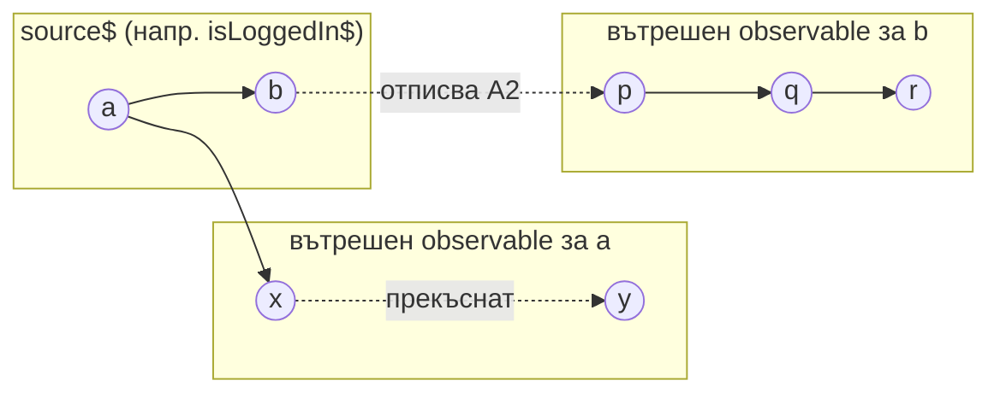

---
tags:
  - rxjs
  - operators
  - разбиране
type: разбиране
свързани:
  - "[[rxjs-observable]]"
  - "[[rxjs-hot-cold]]"
  - "[[dskhome-favourite-listing-store]]"
---

# switchMap — наблюдателят, който изоставя предишната река

## Разбиране

В реката, която Наблюдателят следи, всяка нова вълна носи повод за ново пътуване надолу по течението — заявка към API, отваряне на нов диалог, ново търсене в поле за филтриране. Проблемът, пред който се изправя Наблюдателят всеки път, е следният: какво да прави, ако тръгне след една вълна надолу по притока ѝ, а междувременно на главната река пристигне следваща вълна, преди първото пътуване да е приключило?

`switchMap` е отговорът на Наблюдателя, който никога не разследва два притока едновременно. В мига, в който пристигне нова стойност от source observable-а, той изоставя текущото си пътуване по вътрешния observable — отписва се от него, независимо докъде е стигнало — и веднага потегля по новия приток, породен от новопристигналата стойност. Затова `switchMap` е естественият избор там, където единствено последната заявка има значение, а резултатите от по-старите вече закъснели заявки биха били подвеждащи, ако се появят по-късно — типично поле за търсене, автоматично довършване, или ефект, реагиращ на смяна на логнат потребител, какъвто е примерът с `getIsFavoriteListing` в `FavouriteListingStore`.

Тази прекъсваща природа на `switchMap` е едновременно неговата сила и капанът му. Силата е в автоматичното анулиране на остарели, вече ненужни HTTP заявки — Angular `HttpClient`, бидейки cold observable, честно спира самата мрежова заявка при отписване, така че `switchMap` реално пести мрежов трафик, а не просто игнорира отговора. Капанът се появява, когато вътрешният observable носи странична операция, която не бива да бъде прекъсвана насред пътя си — например запис в база данни или изпращане на плащане — защото там прекъсването не отменя ефекта в света извън потока, а само кара кода да спре да го наблюдава. За такива случаи Наблюдателят посяга не към `switchMap`, а към `concatMap` или `exhaustMap`, всеки от които решава конфликта между припокриващи се вълни по различен начин.

### Marble диаграма



Вълна `a` поражда вътрешен поток, който излъчва `x`, но преди да стигне до `y`, пристига вълна `b` — и `switchMap` прекъсва вътрешния поток на `a`, преди `y` изобщо да бъде излъчен, а после стартира изцяло нов вътрешен поток за `b`.

### Закотвяне в реален код

Виж [[dskhome-favourite-listing-store]] за реалния пример от `getIsFavoriteListing` — там `switchMap` е обвит в `tapResponse` именно защото прекъсването на вътрешния observable не бива да убива външния ефект при грешка (виж [[rxjs-tapresponse]]).

```typescript
readonly getIsFavoriteListing = this.effect((isLoggedIn$: Observable<boolean>) => {
  return isLoggedIn$.pipe(
    filter((isLoggedIn) => isLoggedIn),
    withLatestFrom(this.listingId$),
    switchMap(([_, listingId]) =>
      this.dskhomeFavouritesApiService.getSingleListingToFavorite(listingId).pipe(
        tapResponse(
          (res) => this.updateIsFavorite(res.favorite),
          (error: HttpErrorResponse) => this.setErrorFavorite(error),
        ),
      ),
    ),
  );
});
```

## Активиране

> [!question] Какво прави `switchMap`, когато пристигне нова стойност от source observable-а, докато вътрешният observable все още не е завършил?
> Отписва се незабавно от текущия вътрешен observable — прекъсва го — и стартира нов вътрешен observable за новопристигналата стойност.

> [!question] Защо `switchMap` е подходящ за поле за търсене, но неподходящ за изпращане на плащане?
> Защото прекъсва вътрешния поток при нова стойност: за търсене остарелите резултати стават ненужни и трябва да се отменят, докато при плащане прекъсването спира само наблюдението, не самата операция в реалния свят — заявката вече е тръгнала.

> [!question] Кой оператор избираш вместо `switchMap`, когато искаш всяка вътрешна операция да завърши, преди следващата да започне?
> `concatMap` — той опашва новите вътрешни observables вместо да прекъсва текущия.

> [!question] Защо `switchMap` реално спестява мрежов трафик, а не просто игнорира стар отговор?
> Защото `HttpClient` observable-ите са cold — отписването реално прекратява самата HTTP заявка, не просто маскира резултата ѝ.

---
*Темплейт по модела "Разбиране / Активиране" — виж [[ucha-se-метод]] за пълното описание на структурата.*
